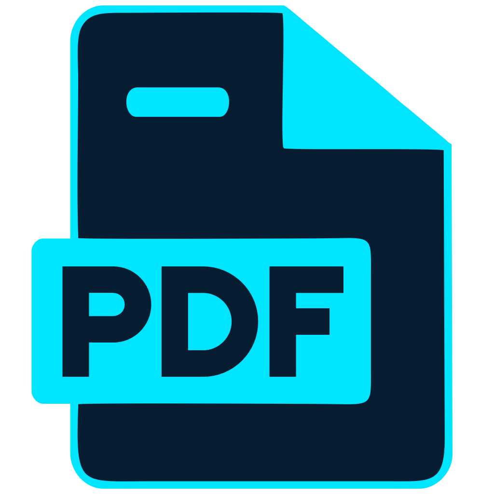

<p align="center">
  
</p>

## 📄 CyberPDF {{VERSION}}: Release Notes

### 🚀 What's new in this release

<!-- IMPORTANT FOR AGENTS & MAINTAINERS: rewrite this whole section with the actual notes for this release before tagging. Never leave the previous version's notes here. -->
<!-- COVERAGE: list every commit since the previous tag before drafting. Give every user-facing change at least one highlight and group related commits into one. Skip internal refactors, CI, tests and dependency bumps with no visible effect; keep small visible fixes such as copy, tooltips, shortcuts, themes, icons, spacing, stability and perceptible performance. Review the draft if 15+ user-facing commits produce fewer than 6 highlights, or 40+ total commits fewer than 8. Patch releases may have 1-3 highlights or a plain maintenance-only note. -->

<!-- changelog-summary:start -->
First release: a native PDF reader with continuous scrolling, fit-width zoom, rotation, text selection with copy, full-document search, and three themes in English and Spanish.
<!-- changelog-summary:end -->

> **New to CyberPDF?** A fast, lightweight PDF reader for Windows, built to open in under half a second.

---

### ✨ Key Features & Highlights

- 📖 **Reads PDFs in one window**: continuous scrolling, zoom from 10% to 800%, fit width, and rotation in 90 degree steps.
- 📋 **Select and copy text**: drag to select, double click for a word, triple click for a line, Ctrl+C to copy.
- 🔎 **Search with highlighting**: Ctrl+F finds every match in the document, highlights all of them, and F3 jumps between results.
- 🎨 **Three themes**: Default, Gray and Light, switchable from the title bar.
- 🌍 **English and Spanish**, following Windows by default.
- 🪶 **Small and fast**: opens in about a quarter of a second and uses 20-50 MB of memory.

<details>
<summary><b>🇪🇸 Ver notas de la versión en Español</b></summary>

### 🚀 Novedades de esta versión

Primera versión: un lector de PDF nativo con desplazamiento continuo, zoom ajustado al ancho, rotación, selección de texto con copia, búsqueda en todo el documento y tres temas en inglés y español.

> **¿Nuevo en CyberPDF?** Un lector de PDF rápido y ligero para Windows, que abre en menos de medio segundo.

---

### ✨ Novedades destacadas

- 📖 **Lee PDFs en una ventana**: desplazamiento continuo, zoom de 10% a 800%, ajustar al ancho y rotación en pasos de 90 grados.
- 📋 **Selecciona y copia texto**: arrastra para seleccionar, doble clic para una palabra, triple clic para una línea, Ctrl+C para copiar.
- 🔎 **Búsqueda con resaltado**: Ctrl+F encuentra todas las coincidencias del documento, las resalta y F3 salta entre los resultados.
- 🎨 **Tres temas**: Predeterminado, Gris y Claro, desde la barra de título.
- 🌍 **Inglés y español**, siguiendo Windows por defecto.
- 🪶 **Pequeño y rápido**: abre en un cuarto de segundo y usa 20-50 MB de memoria.

### ℹ️ Antes de instalar

- **Windows:** esta versión aún no está firmada digitalmente. SmartScreen puede avisar antes de ejecutarla: **Más información › Ejecutar de todas formas**. Cuando Smart App Control está activado, Windows rechaza programas sin firmar; consulta la [política de firma de código](https://github.com/CyberGems/.github/blob/main/CODE_SIGNING.md). Verifica la descarga con los checksums SHA256 que aparecen más abajo.

</details>

---

### ℹ️ Before you install

- **Windows:** this release is not code-signed yet. SmartScreen may ask before it runs: **More info › Run anyway**. Where Smart App Control is on, Windows refuses unsigned programs; see the [code signing policy](https://github.com/CyberGems/.github/blob/main/CODE_SIGNING.md). Verify the download with the SHA256 checksums below.

---

### 📦 Downloads & Packages

> ⬇️ **Direct download:** click a file name to download it now. Same files as in **Assets** at the bottom of this page.

| File | Description | Platform |
| :--- | :--- | :--- |
| **[`CyberPDF-Setup-{{VERSION_BARE}}.exe`](https://github.com/CyberGems/CyberPDF/releases/download/{{VERSION}}/CyberPDF-Setup-{{VERSION_BARE}}.exe)** | 🚀 **Recommended Installer** (Inno Setup, optional `.pdf` association, no administrator rights) | Windows 10 / 11 (x64) |
| **[`CyberPDF-{{VERSION}}-Portable-win-x64.zip`](https://github.com/CyberGems/CyberPDF/releases/download/{{VERSION}}/CyberPDF-{{VERSION}}-Portable-win-x64.zip)** | 💼 **Portable package** (unzip into any folder and run `CyberPDF.exe`) | Windows 10 / 11 (x64) |

---

### 🔐 VirusTotal and SHA256

> 🛡️ The report opens on VirusTotal and does not download anything.

**Installer**: [View VirusTotal report](https://www.virustotal.com/gui/file/{{INSTALLER_HASH}})

```text
{{INSTALLER_HASH}}
```

**Portable**: [View VirusTotal report](https://www.virustotal.com/gui/file/{{PORTABLE_HASH}})

```text
{{PORTABLE_HASH}}
```

---

📜 **Full changelog:** browse every version in [CHANGELOG.md](https://github.com/CyberGems/CyberPDF/blob/main/CHANGELOG.md).

*Crafted with precision by [CyberGems](https://cybergems.org)*
