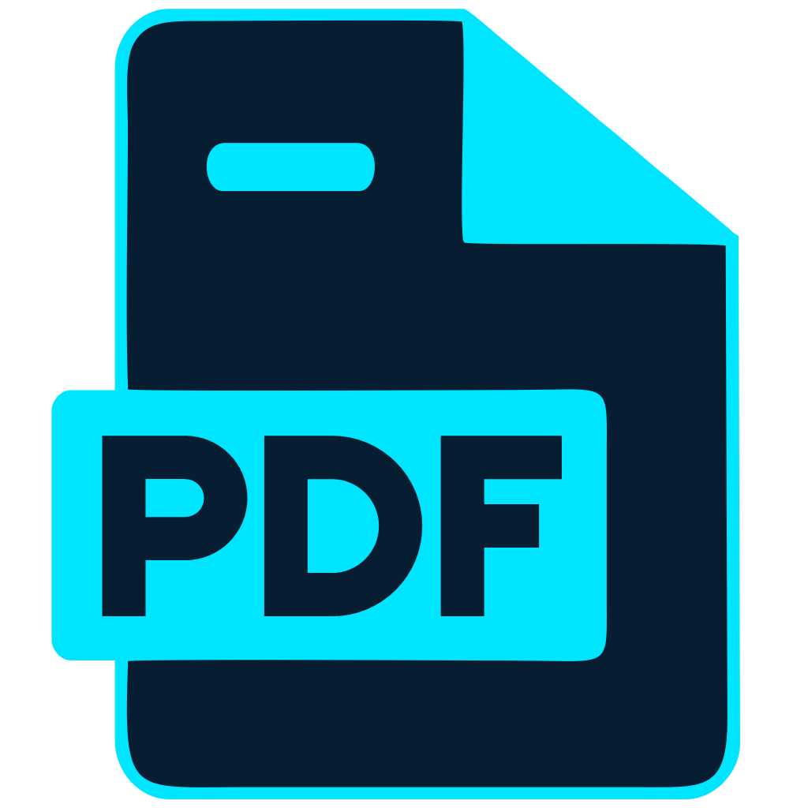
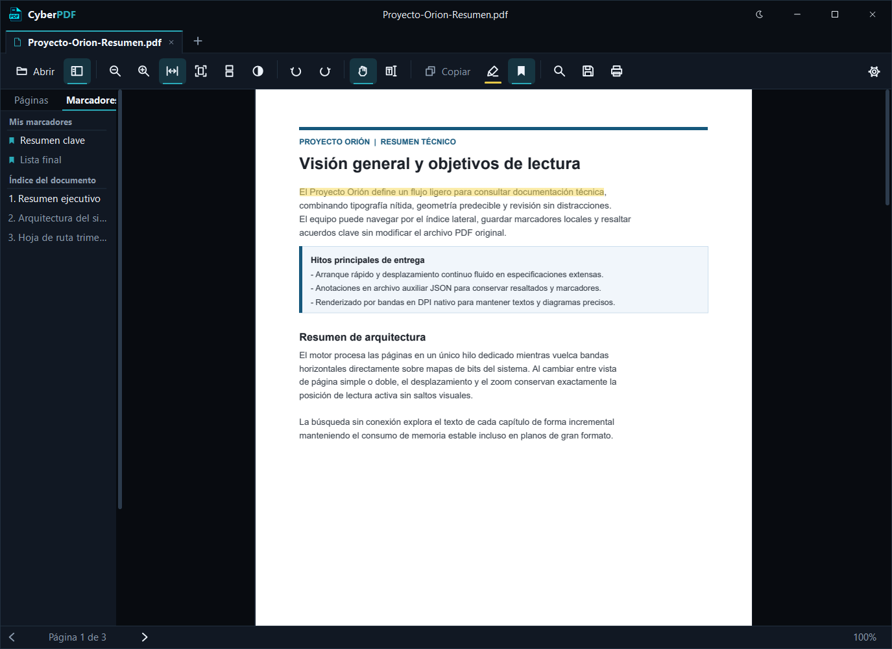
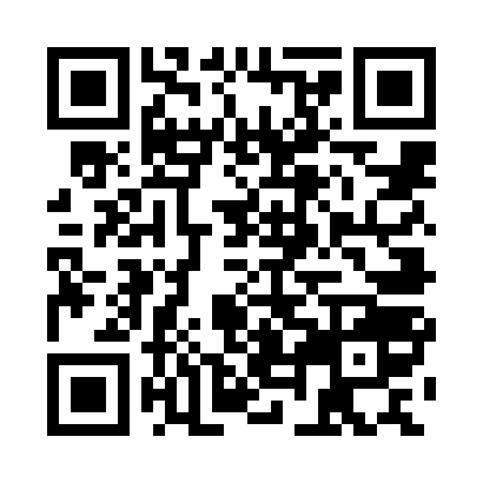

<p align="center">
  <a href="./README.md">English</a> · Español
</p>

<p align="center">
  <a href="https://github.com/CyberGems/CyberPDF">
    
  </a>
</p>

<p align="center">
  <a href="https://github.com/CyberGems/CyberPDF/releases/latest"></a>
  &nbsp;<a href="https://github.com/CyberGems/CyberPDF/releases"></a>
</p>

<p align="center">
  &nbsp;
  &nbsp;
  &nbsp;
  <a href="https://github.com/CyberGems/CyberPDF/wiki"></a>&nbsp;
  <a href="https://github.com/CyberGems/CyberPDF/blob/main/CHANGELOG.md"></a>
</p>

---

<div align="center">

### Un lector de PDF rápido y ligero para Windows, hecho para abrirse en menos de medio segundo.

</div>

---

## 📑 Tabla de contenidos

- [👋 Introducción](#-introducción)
- [🖼️ Capturas](#️-capturas)
- [📕 ¿Por qué CyberPDF?](#-por-qué-cyberpdf)
- [✨ Funciones principales](#-funciones-principales)
- [⬇️ Instalación](#️-instalación)
- [🧭 Cómo usar la app](#-cómo-usar-la-app)
- [🛠️ Stack tecnológico y arquitectura](#️-stack-tecnológico-y-arquitectura)
- [⌨️ Atajos de teclado](#️-atajos-de-teclado)
- [❤️ Donar](#️-donar)
- [📄 Licencia](#-licencia)
- [❓ Preguntas frecuentes](#-preguntas-frecuentes)
- [🔗 Ver también](#-ver-también)

<details>
<summary><strong>🔗 Enlaces relacionados (fuera de este README)</strong></summary>

- 🌐 [CyberPDF en GitHub](https://github.com/CyberGems/CyberPDF) — código, versiones e incidencias
- 📚 [Documentación y FAQ — Wiki](https://github.com/CyberGems/CyberPDF/wiki) — guías y solución de problemas
- 💾 [Versiones](https://github.com/CyberGems/CyberPDF/releases) — instaladores, portátiles y registro de cambios
- 🟣 [Suite CyberGems](https://github.com/CyberGems) — todas las apps de código abierto

</details>

---

## 👋 Introducción

CyberPDF es un lector de PDF nativo para Windows basado en el motor PDFium de Chromium. Abre varios documentos en pestañas, genera las páginas en franjas directamente en el mapa de bits de la ventana y conserva por documento los resaltados, marcadores, página, zoom y rotación. Tres temas, cambio de idioma español e inglés en vivo, y ninguna cuenta ni servicio en la nube.

*Gratis y de código abierto: sin anuncios, sin rastreo, sin telemetría y sin SDK de análisis. Solo abre tus PDF.*

---

## 🖼️ Capturas



_Ventana del lector en tema predeterminado con el panel lateral (marcadores personales e índice del documento) y un resaltado guardado._

---

## 📕 ¿Por qué CyberPDF?

Muchos lectores ligeros arrancan rápido pero no tienen las herramientas que usas cada día, o las añaden y se vuelven lentos. CyberPDF mantiene el acceso directo a PDFium e incluye pestañas, resaltados de texto, marcadores personales, búsqueda, impresión y enlaces clicables. El motor pinta directamente en el mapa de bits que dibuja la ventana, las páginas se generan en franjas horizontales, un único hilo serializado atiende todas las peticiones, solo se dibuja lo visible y los renders obsoletos se descartan en cuanto cambia el zoom o el tamaño.

---

## ✨ Funciones principales

- Pestaña de inicio y pestañas de documentos (`+` o `Ctrl+T`) con archivos recientes y arrastrar y soltar
- Varios PDF abiertos a la vez (`Ctrl+Tab` para cambiar, `Ctrl+W` para cerrar una pestaña)
- Abre desde el diálogo, arrastrando o por línea de comandos, con diálogo de contraseña temático para archivos protegidos
- Modos continuo, página única y dos páginas, más un filtro nocturno opcional (`Alt+N`)
- Desplazamiento vertical y horizontal con barras temáticas, rueda del ratón (`Ctrl+Rueda` para zoom, `Shift+Rueda` en horizontal), botón central y herramienta mano predeterminada (`Alt+H`)
- Herramienta de selección de texto (`Alt+S`), copia y resaltados en cuatro colores (`Alt+M` o menú contextual de la página), con el color activo recordado y anotaciones guardadas por documento en `%LOCALAPPDATA%\CyberPDF\annotations.json`
- Marcadores personales por página (`Ctrl+B`) en el panel lateral sobre el índice, renombrables en línea y señalados con una cinta en las miniaturas
- Enlaces internos clicables y enlaces web o de correo externos
- Búsqueda flotante arriba a la derecha (`Ctrl+F`) con mayúsculas (`Aa`), palabra completa (`ab`), contador y navegación con `Enter` / `Shift+Enter` sin mover el diseño de la página
- Panel lateral con miniaturas y marcadores (`F4`), borde redimensionable y estado recordado por documento
- Barra de estado interactiva: página anterior y siguiente, clic en el contador (`Ctrl+G`) para saltar y clic en el zoom para ajustes rápidos
- Guardar una copia (`Ctrl+S`), impresión (`Ctrl+P`), propiedades del documento (`Ctrl+D`) y recarga (`F5`)
- Zoom de 10% a 800%, ajustar al ancho, ajustar página completa, volver al 100% y rotación en pasos de 90 grados
- Tres temas, cambio de idioma español e inglés en vivo y configuración como lector de PDF predeterminado en Ajustes (y activada por defecto en el instalador)
- Icono en la bandeja del sistema con menú rápido temático (Mostrar/Ocultar, Abrir PDF, Ajustes, Más recientes, Ayuda, Acerca de y búsqueda de actualizaciones)
- Diálogo Acerca de con icono oficial, comprobación de actualizaciones en GitHub, copia de diagnósticos y enlaces a las apps de la suite CyberGems
- Una sola ventana por sesión: abrir otro PDF crea una pestaña nueva en la ventana activa

---

## ⬇️ Instalación

### Instalar (recomendado)

1. Descarga el último instalador desde [Versiones](https://github.com/CyberGems/CyberPDF/releases/latest).
2. Ejecuta `CyberPDF-Setup-<version>.exe`. No necesita permisos de administrador y puede asociar los archivos `.pdf` con CyberPDF.
3. Inicia CyberPDF. No hace falta el runtime de .NET ni herramientas de desarrollo: la compilación publicada es autocontenida.

### Versión portátil

- Descarga `CyberPDF-<version>-Portable-win-x64.zip` desde la [última versión](https://github.com/CyberGems/CyberPDF/releases/latest).
- Descomprime en cualquier carpeta y ejecuta `CyberPDF.exe`.
- Los ajustes se quedan junto al ejecutable, así que la carpeta puede viajar en un USB.

### 🛡️ Windows SmartScreen

Windows puede avisar la primera vez que ejecutes el instalador porque la app aún no está firmada digitalmente. El código es público, así que puedes comprobar exactamente qué hace. Cuando Smart App Control está activado, Windows rechaza programas sin firmar; consulta la [política de firma de código](https://github.com/CyberGems/.github/blob/main/CODE_SIGNING.md). Verifica la descarga con los checksums SHA-256 de las notas de la versión.

---

## 🧭 Cómo usar la app

Arrancas en la pestaña de inicio con tus archivos recientes. Abre un PDF con `Ctrl+O`, arrástralo a la ventana o pasa una ruta por línea de comandos. Elige Continuo, Página única o Dos páginas desde la barra de herramientas y usa el panel lateral para miniaturas, marcadores e índice del documento.

Los resaltados y marcadores se guardan localmente por documento, así que no hace falta una cuenta. Los PDF protegidos piden contraseña en un diálogo temático, y la última página, el zoom y la rotación vuelven al reabrir el documento.

Para la guía completa, consulta [Cómo usar CyberPDF](https://github.com/CyberGems/CyberPDF/wiki/How-Do-You-Use-es).

---

## 🛠️ Stack tecnológico y arquitectura

### Entorno de ejecución

CyberPDF es una aplicación WinForms sobre .NET 10 que llama a PDFium de Chromium mediante P/Invoke directo. La compilación publicada es autocontenida, así que Windows no necesita tener instalado el runtime de .NET.

### Por qué es rápido

- **PDFium pinta directamente en el mapa de bits que dibuja la ventana.** Los píxeles de cada página existen una sola vez en memoria, no dos.
- **Las páginas se generan en franjas horizontales.** Un póster se convierte en unas pocas reservas pequeñas en lugar de un búfer enorme.
- **Un solo hilo de render, una sola cola.** El motor no es seguro entre hilos, y una tubería serializada es correcta y suficientemente rápida.
- **Solo se genera lo visible**, con una pantalla de precarga.
- **Los renders obsoletos se descartan explícitamente** al cambiar el zoom o el tamaño, en lugar de quedarse hasta que el presupuesto de caché los expulse.

### Medido

Compilación autocontenida, medida en la máquina de desarrollo:

| | |
|---|---|
| Arranque | 0,24-0,36 s |
| Memoria, ventana vacía | 19 MB privados (59 MB residentes) |
| Memoria, documento normal | 24 MB privados (65 MB residentes) |
| Memoria, página alta extrema | 50 MB privados (91 MB residentes) |
| Descarga del instalador | 38 MB |
| Instalado | 122 MB |

Los detalles completos y las alternativas descartadas están en [docs/architecture.md](docs/architecture.md).

### Compilar desde el código

Requisitos: Windows 10 1803 o posterior, .NET SDK 10 y PowerShell 5.1 o posterior.

```powershell
# Restaurar el motor nativo (descarga y verifica PDFium)
./scripts/Fetch-Pdfium.ps1

# Compilar y ejecutar
dotnet build CyberPDF.slnx -c Release
./src/CyberPDF.UI/bin/Release/net10.0-windows/CyberPDF.exe

# Ejecutar sin compilar aparte, con un documento opcional
dotnet run --project src/CyberPDF.UI/CyberPDF.UI.csproj -c Release -- documento.pdf

# Pruebas
dotnet test CyberPDF.slnx -c Release

# Compilación autocontenida en carpeta
./scripts/Publish-CyberPDF.ps1
```

### Verificar una compilación

Hay dos modos ocultos para comprobar una compilación en una máquina real:

```powershell
# Imprime métricas de diseño, franjas y memoria para un documento
CyberPDF.exe --diag documento.pdf --diag-out informe.txt

# Igual, pero se desplaza y hace zoom antes: ahí es donde aparecería una fuga
CyberPDF.exe --diag --stress documento.pdf --diag-out informe.txt

# Guarda la ventana tal como la pinta la propia aplicación
CyberPDF.exe --shot salida.png documento.pdf
```

---

## ⌨️ Atajos de teclado

| Teclas | Acción |
|---|---|
| `Ctrl+O` | Abrir un documento |
| `Ctrl++` / `Ctrl+-` / `Ctrl+Rueda` | Acercar / alejar |
| `Ctrl+0` | Tamaño real |
| `Ctrl+R` | Girar en sentido horario |
| `Alt+R` | Girar en sentido antihorario |
| `Alt+W` | Ajustar al ancho |
| `Alt+P` | Ajustar página completa |
| `Alt+H` | Herramienta mano (desplazar, predeterminada) |
| `Alt+S` | Herramienta de selección de texto |
| `Alt+N` | Alternar modo nocturno de página |
| `Alt+T` | Cambiar tema |
| `Ctrl+F` | Buscar en el documento |
| `Ctrl+G` | Ir a página |
| `Ctrl+S` | Guardar una copia (`Guardar como...`) |
| `Ctrl+P` | Imprimir |
| `Ctrl+D` | Propiedades del documento |
| `F4` | Miniaturas y marcadores |
| `F5` | Recargar documento |
| `F3` | Siguiente coincidencia |
| `Shift+F3` | Coincidencia anterior |
| `Ctrl+C` | Copiar la selección |
| `Ctrl+A` | Seleccionar la página actual |
| `Alt+M` | Resaltar la selección |
| `Ctrl+B` | Alternar marcador en la página actual |
| `Ctrl+T` | Abrir una nueva pestaña de inicio |
| `Ctrl+Tab` | Siguiente pestaña abierta |
| `Ctrl+W` | Cerrar pestaña activa o ventana |
| `F11` | Maximizar / restaurar |
| `Av Pág` / `Re Pág` | Desplazar una pantalla o cambiar de página |
| `Inicio` / `Fin` | Principio / final del documento |

---

## ❤️ Donar

**CyberPDF** es 100% gratuito y de código abierto. Si te resulta útil, considera [donar](https://cybergems.org/es/donate) o [dar una estrella al repo en GitHub](https://github.com/CyberGems/CyberPDF) para apoyar el desarrollo. [Lee la historia completa](https://cybergems.org/es/about/) detrás del proyecto. ¡Gracias! 🙏

<p align="center">
  <a href="https://github.com/sponsors/CyberGems"></a>
</p>

<p align="center">
  <a href="https://www.paypal.com/donate/?hosted_button_id=M4PY3UPJA5Y6Q"></a>
</p>

<p align="center">
  <a href="https://ko-fi.com/cybergems"></a>
</p>

<p align="center">
  <a href="https://buymeacoffee.com/cybergems"></a>
</p>

<div align="center">

<details>
<summary><b>Donaciones en cripto (BTC, ETH, USDT, LTC) — pulsa para ver las direcciones</b></summary>

| Activo | Dirección | QR |
|---|---|---|
| **&nbsp;&nbsp;BTC** | <pre><code>bc1q5mxzz05nmvsheqzx7970euswta3fksxzcfzag4</code></pre> |  |
| **&nbsp;&nbsp;ETH** | <pre><code>0x79b703Ec0f77493679Fcd280aF3b983E20c580B8</code></pre> |  |
| **&nbsp;&nbsp;USDT (ERC20 / BEP20)** | <pre><code>0x79b703Ec0f77493679Fcd280aF3b983E20c580B8</code></pre> |  |
| **&nbsp;&nbsp;USDT (TRC20)** | <pre><code>TSVbSk1HSyZ1NprCnAYiw56ECwXgH887mD</code></pre> |  |
| **&nbsp;&nbsp;LTC** | <pre><code>LWGnEHgcFCE2BRkzLnsdPDD8Y8ZeDK577X</code></pre> |  |

> ⚠️ Envía solo el activo indicado en la red indicada. Usar la red equivocada puede perder los fondos de forma permanente.

</details>

</div>

---

## 📄 Licencia

CyberPDF se distribuye bajo los términos de la GNU General Public License v3.0. Consulta [LICENSE](LICENSE) para leer el texto completo. PDFium y sus dependencias incluidas se distribuyen con sus propias licencias, que acompañan a la compilación publicada.

Copyright (C) 2026 CyberGems

---

## ❓ Preguntas frecuentes

Para preguntas frecuentes y solución de problemas, consulta la [FAQ](https://github.com/CyberGems/CyberPDF/wiki/FAQ-es).

---

## 🔗 Ver también

Más apps gratuitas, de código abierto y que respetan tu privacidad, de [**CyberGems**](https://github.com/CyberGems):

| App | Descripción |
|:---:|---|
| 🕐&nbsp;[**CyberClock**](https://github.com/CyberGems/CyberClock#readme) | Reloj, calendario, temporizadores, sonidos ambientales y reloj hablado opcional en una app ligera. |
| 📢&nbsp;[**CyberFeeds**](https://github.com/CyberGems/CyberFeeds#readme) | Lector RSS y Atom local de alto rendimiento, rápido, privado y cómodo para leer. |
| 🚀&nbsp;[**CyberLauncher**](https://github.com/CyberGems/CyberLauncher#readme) | Lanzador de apps para Windows con esquinas activas, programador, monitor del sistema y terminal integrado. |
| 💻&nbsp;[**CyberManager**](https://github.com/CyberGems/CyberManager#readme) | Gestor de tareas ligero y rápido, virtualizado y nativo de NT, una alternativa potente al Administrador de tareas. |
| 📝&nbsp;[**CyberNotes**](https://github.com/CyberGems/CyberNotes#readme) | App de notas privada con texto enriquecido, carpetas, pestañas y almacenamiento local protegido con bcrypt. |
| ⚡&nbsp;[**CyberPaste**](https://github.com/CyberGems/CyberPaste#readme) | Gestor del portapapeles privado para texto, código, imágenes, HTML y archivos. |
| 📸&nbsp;[**CyberSnap**](https://github.com/CyberGems/CyberSnap#readme) | Suite de capturas y anotación con herramientas vectoriales, OCR rápido, grabación y cuentagotas. |
| ⭐&nbsp;[**CyberTray**](https://github.com/CyberGems/CyberTray#readme) | Lanzador de bandeja de alto rendimiento con hotspots, monitorización, gestor de procesos y vault protegido por PIN. |
| 💫&nbsp;[**CyberViewer**](https://github.com/CyberGems/CyberViewer#readme) | Visor y editor de imágenes completo, pensado para usuarios ocasionales y avanzados. |
| 🛡️&nbsp;[**CyberWall**](https://github.com/CyberGems/CyberWall#readme) | Firewall de Windows fácil de usar con reglas por app en tiempo real basadas en el motor WFP del kernel. |

➡️ **[Todas las aplicaciones en cybergems.org](https://cybergems.org/es/)**

<div align="center" style="background:#0D0F17; border:1px solid rgba(0,255,255,0.12); border-radius:12px; padding:28px 20px; margin-top:32px;">

### ¡Gracias por usar CyberPDF! 🎉

Hecho por [**CyberGems**](https://cybergems.org/es/)

</div>
