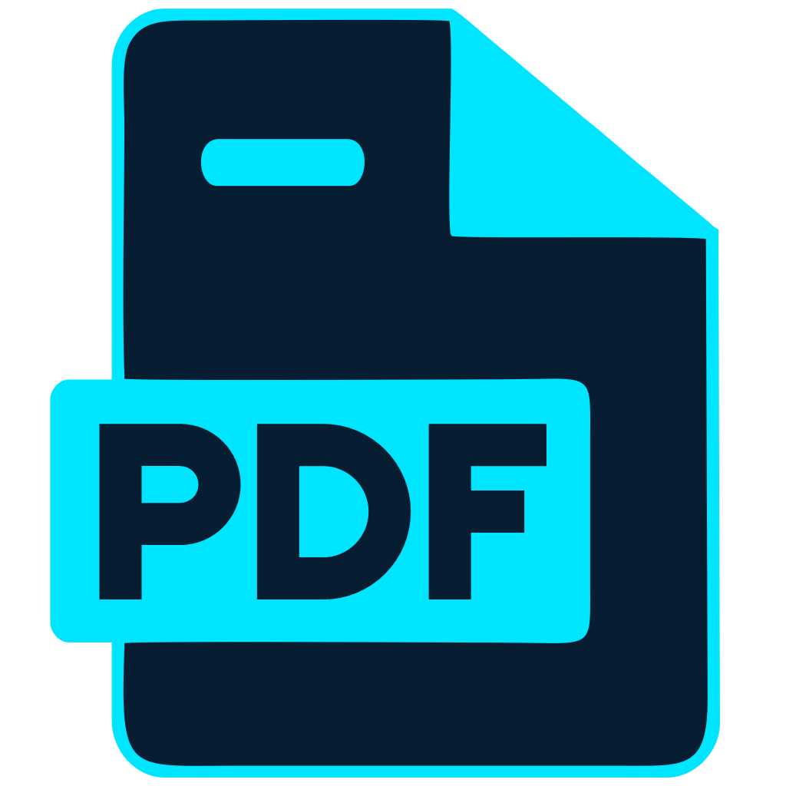
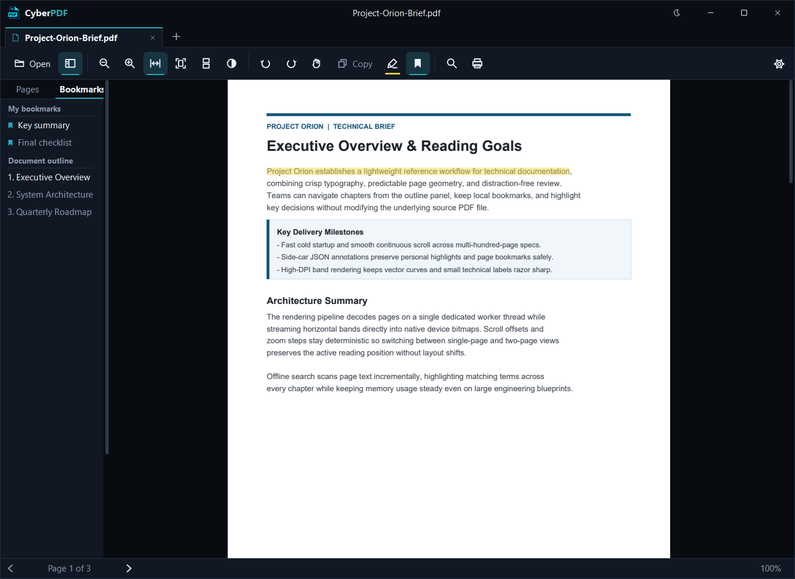

<p align="center">
  English · <a href="./README.es.md">Español</a>
</p>

<p align="center">
  <a href="https://github.com/CyberGems/CyberPDF">
    
  </a>
</p>

<p align="center">
  <a href="https://github.com/CyberGems/CyberPDF/releases/latest"></a>
  &nbsp;<a href="https://github.com/CyberGems/CyberPDF/releases"></a>
</p>

<p align="center">
  &nbsp;
  &nbsp;
  &nbsp;
  <a href="https://github.com/CyberGems/CyberPDF/wiki"></a>&nbsp;
  <a href="https://github.com/CyberGems/CyberPDF/blob/main/CHANGELOG.md"></a>
</p>

---

<div align="center">

### A fast, lightweight PDF reader for Windows, built to open in under half a second.

</div>

---

## 📑 Table of Contents

- [👋 Introduction](#-introduction)
- [🖼️ Screenshots](#️-screenshots)
- [📕 Why CyberPDF?](#-why-cyberpdf)
- [✨ Key Features](#-key-features)
- [⬇️ Installation](#️-installation)
- [🧭 Using the App](#-using-the-app)
- [🛠️ Tech Stack & Architecture](#️-tech-stack--architecture)
- [⌨️ Keyboard Shortcuts](#️-keyboard-shortcuts)
- [❤️ Donate](#️-donate)
- [📄 License](#-license)
- [❓ FAQ](#-faq)
- [🔗 See also](#-see-also)

<details>
<summary><strong>🔗 Related links (outside this README)</strong></summary>

- 🌐 [CyberPDF on GitHub](https://github.com/CyberGems/CyberPDF) — source, releases and issue tracker
- 📚 [Documentation & FAQ — Wiki](https://github.com/CyberGems/CyberPDF/wiki) — guides and troubleshooting
- 💾 [Releases](https://github.com/CyberGems/CyberPDF/releases) — installers, portable builds and changelog
- 🟣 [CyberGems suite](https://github.com/CyberGems) — all open-source apps

</details>

---

## 👋 Introduction

CyberPDF is a native Windows PDF reader built around Chromium's PDFium engine. It opens multiple documents in tabs, renders pages in bands straight into the window bitmap, and keeps highlights, bookmarks, page position, zoom and rotation per document. Three themes, live English and Spanish, and no account or cloud service are involved.

*Free and open source: no ads, no tracking, no telemetry and no analytics SDK. Just open your PDFs.*

---

## 🖼️ Screenshots



_Reader window in Default theme with the side panel (personal bookmarks and document outline) and a saved text highlight._

---

## 📕 Why CyberPDF?

Most lightweight readers either start fast but lack the tools you use every day, or add those tools and become slow. CyberPDF keeps the direct PDFium path and still includes tabs, text highlights, personal bookmarks, search, printing and clickable links. The engine paints straight into the bitmap the window draws, pages render in horizontal bands, one serialized render thread serves every request, only visible pages are drawn, and stale renders are dropped as soon as zoom or size changes.

---

## ✨ Key Features

- Start tab and new document tabs (`+` or `Ctrl+T`) with recent files and drag-and-drop support
- Multiple PDFs open at once (`Ctrl+Tab` to switch, `Ctrl+W` to close a tab)
- Open by dialog, drag and drop or command line, with a themed password prompt for protected files
- Continuous, single-page and two-page layouts, plus an optional dark page filter (`Alt+N`)
- Vertical and horizontal scrolling with themed scrollbars, mouse wheel (`Ctrl+Wheel` to zoom, `Shift+Wheel` horizontally), middle-drag and hand tool (`Alt+H`)
- Text selection, copy and highlights in four colors (`Alt+M` or the page context menu), with the default color remembered and annotations saved per document in `%LOCALAPPDATA%\CyberPDF\annotations.json`
- Personal page bookmarks (`Ctrl+B`) shown in the side panel above the outline, renameable inline and marked with a ribbon on thumbnails
- Clickable internal links and external web or mail links
- Floating top-right search (`Ctrl+F`) with match case (`Aa`), whole word (`ab`), counter and `Enter` / `Shift+Enter` navigation without shifting the page layout
- Side panel with thumbnails and bookmarks (`F4`), resizable edge and state remembered per document
- Interactive status bar: previous and next page, click the page counter (`Ctrl+G`) to jump, click the zoom percentage for presets
- Printing (`Ctrl+P`), document properties (`Ctrl+D`) and reload (`F5`)
- Zoom from 10% to 800%, fit width, fit page, 100% reset and rotation in 90 degree steps
- Three themes, live English and Spanish switching, and default PDF reader setup in Settings (and checked by default in the installer)
- System tray icon and themed quick menu (Show/Hide, Open PDF, Settings, Most recent PDFs, Help, About and update check)
- About dialog with official icon, GitHub update check, one-click diagnostics copy and links to sibling CyberGems apps
- One window per session: opening another PDF creates a new tab in the running window

---

## ⬇️ Installation

### Install (Recommended)

1. Download the latest installer from [Releases](https://github.com/CyberGems/CyberPDF/releases/latest).
2. Run `CyberPDF-Setup-<version>.exe`. It needs no administrator rights and can associate `.pdf` files with CyberPDF.
3. Launch CyberPDF. No .NET runtime or developer tools are needed: the published build is self-contained.

### Portable Version

- Download `CyberPDF-<version>-Portable-win-x64.zip` from the [latest release](https://github.com/CyberGems/CyberPDF/releases/latest).
- Extract it to any folder and run `CyberPDF.exe`.
- Settings stay beside the executable, so the folder can travel on a USB drive.

### 🛡️ Windows SmartScreen

Windows may warn the first time you run the installer because the app is not code-signed yet. The source is public, so you can inspect exactly what it does. When Smart App Control is on, Windows refuses unsigned programs; see the [code signing policy](https://github.com/CyberGems/.github/blob/main/CODE_SIGNING.md). Verify the download with the SHA-256 checksums in the release notes.

---

## 🧭 Using the App

You start on the Start tab with your recent files. Open a PDF with `Ctrl+O`, drop it into the window, or pass a path on the command line. Pick Continuous, Single Page or Two Pages from the toolbar, then use the side panel for thumbnails, bookmarks and the document outline.

Highlights and bookmarks are stored locally per document, so no account is needed. Protected PDFs ask for a password in a themed prompt, and the last page, zoom and rotation come back when you reopen a document.

For the full walkthrough, see [How Do You Use CyberPDF?](https://github.com/CyberGems/CyberPDF/wiki/How-Do-You-Use).

---

## 🛠️ Tech Stack & Architecture

### Runtime

CyberPDF is a WinForms application on .NET 10 that calls Chromium's PDFium through direct P/Invoke. The published build is self-contained, so Windows does not need a .NET runtime installed.

### Why it is fast

- **PDFium paints straight into the bitmap the window draws.** Page pixels exist once in memory, not twice.
- **Pages render in horizontal bands.** A poster-sized page becomes a few small allocations instead of one huge buffer.
- **One render thread, one queue.** The engine is not thread-safe, and a serialized pipeline is both correct and fast enough.
- **Only what is visible gets rendered**, with one viewport of prefetch.
- **Stale renders are dropped explicitly** when zoom or size changes, instead of lingering until a cache budget evicts them.

### Measured

Self-contained build, measured on the development machine:

| | |
|---|---|
| Startup | 0.24-0.36 s |
| Memory, empty window | 19 MB private (59 MB working set) |
| Memory, ordinary document | 24 MB private (65 MB working set) |
| Memory, worst-case tall page | 50 MB private (91 MB working set) |
| Installer download | 38 MB |
| Installed | 122 MB |

See [docs/architecture.md](docs/architecture.md) for the full measurements and the alternatives that were rejected.

### Building from source

Requirements: Windows 10 1803 or later, .NET SDK 10, and PowerShell 5.1 or later.

```powershell
# Restore the native engine (downloads and verifies PDFium)
./scripts/Fetch-Pdfium.ps1

# Build and run
dotnet build CyberPDF.slnx -c Release
./src/CyberPDF.UI/bin/Release/net10.0-windows/CyberPDF.exe

# Run without building separately, optionally opening a document
dotnet run --project src/CyberPDF.UI/CyberPDF.UI.csproj -c Release -- document.pdf

# Tests
dotnet test CyberPDF.slnx -c Release

# Self-contained folder build
./scripts/Publish-CyberPDF.ps1
```

### Verifying a build

Two hidden modes check a build on a real machine:

```powershell
# Print layout, band and memory metrics for a document
CyberPDF.exe --diag document.pdf --diag-out report.txt

# Same, but scroll and zoom first, which is where a leak would show
CyberPDF.exe --diag --stress document.pdf --diag-out report.txt

# Save the window as the app paints it
CyberPDF.exe --shot out.png document.pdf
```

---

## ⌨️ Keyboard Shortcuts

| Keys | Action |
|---|---|
| `Ctrl+O` | Open a document |
| `Ctrl++` / `Ctrl+-` / `Ctrl+Wheel` | Zoom in / out |
| `Ctrl+0` | Actual size |
| `Ctrl+R` | Rotate clockwise |
| `Alt+R` | Rotate counterclockwise |
| `Alt+W` | Fit width |
| `Alt+P` | Fit whole page |
| `Alt+H` | Toggle hand / select tool |
| `Alt+N` | Toggle dark page mode |
| `Alt+T` | Change theme |
| `Ctrl+F` | Search in the document |
| `Ctrl+G` | Go to page |
| `Ctrl+P` | Print |
| `Ctrl+D` | Document properties |
| `F4` | Thumbnails and bookmarks |
| `F5` | Reload document |
| `F3` | Next match |
| `Shift+F3` | Previous match |
| `Ctrl+C` | Copy the selection |
| `Ctrl+A` | Select the current page |
| `Alt+M` | Highlight the selection |
| `Ctrl+B` | Toggle bookmark on current page |
| `Ctrl+T` | Open a new start tab |
| `Ctrl+Tab` | Next open tab |
| `Ctrl+W` | Close active tab or window |
| `F11` | Maximize / restore |
| `Page Up` / `Page Down` | Scroll a screen or step page |
| `Home` / `End` | Start / end of document |

---

## ❤️ Donate

**CyberPDF** is 100% free and open source. If it helps you, please consider [donating](https://cybergems.org/donate) or [starring the repo on GitHub](https://github.com/CyberGems/CyberPDF) to support continued development. [Read the full story](https://cybergems.org/about/) behind the project. Thank you! 🙏

<p align="center">
  <a href="https://github.com/sponsors/CyberGems"></a>
</p>

<p align="center">
  <a href="https://www.paypal.com/donate/?hosted_button_id=M4PY3UPJA5Y6Q"></a>
</p>

<p align="center">
  <a href="https://ko-fi.com/cybergems"></a>
</p>

<p align="center">
  <a href="https://buymeacoffee.com/cybergems"></a>
</p>

<div align="center">

<details>
<summary><b>Crypto donations (BTC, ETH, USDT, LTC) — click to view addresses</b></summary>

| Asset | Address | QR |
|---|---|---|
| **&nbsp;&nbsp;BTC** | <pre><code>bc1q5mxzz05nmvsheqzx7970euswta3fksxzcfzag4</code></pre> |  |
| **&nbsp;&nbsp;ETH** | <pre><code>0x79b703Ec0f77493679Fcd280aF3b983E20c580B8</code></pre> |  |
| **&nbsp;&nbsp;USDT (ERC20 / BEP20)** | <pre><code>0x79b703Ec0f77493679Fcd280aF3b983E20c580B8</code></pre> |  |
| **&nbsp;&nbsp;USDT (TRC20)** | <pre><code>TSVbSk1HSyZ1NprCnAYiw56ECwXgH887mD</code></pre> |  |
| **&nbsp;&nbsp;LTC** | <pre><code>LWGnEHgcFCE2BRkzLnsdPDD8Y8ZeDK577X</code></pre> |  |

> ⚠️ Send only the selected asset on the indicated network. Using the wrong network will result in permanent loss of funds.

</details>

</div>

---

## 📄 License

CyberPDF is distributed under the terms of the GNU General Public License v3.0. See [LICENSE](LICENSE) for the full license text. PDFium and its bundled dependencies ship under their own licenses, included with the published build.

Copyright (C) 2026 CyberGems

---

## ❓ FAQ

For frequently asked questions and troubleshooting, visit the [FAQ](https://github.com/CyberGems/CyberPDF/wiki/FAQ).

---

## 🔗 See also

More free, open-source, privacy-first apps from [**CyberGems**](https://github.com/CyberGems):

| App | Description |
|:---:|---|
| 🕐&nbsp;[**CyberClock**](https://github.com/CyberGems/CyberClock#readme) | Clock, calendar, timers, soundscapes and an optional talking clock in one lightweight app. |
| 📢&nbsp;[**CyberFeeds**](https://github.com/CyberGems/CyberFeeds#readme) | High-performance, local-first RSS and Atom reader built for speed, privacy and clean reading. |
| 🚀&nbsp;[**CyberLauncher**](https://github.com/CyberGems/CyberLauncher#readme) | Windows application launcher with hot corners, scheduler, system monitor and integrated terminal. |
| 💻&nbsp;[**CyberManager**](https://github.com/CyberGems/CyberManager#readme) | Lightweight, high-performance task manager, virtualized and NT-native, a powerful Task Manager alternative. |
| 📝&nbsp;[**CyberNotes**](https://github.com/CyberGems/CyberNotes#readme) | Privacy-focused note-taking app with rich text, folders, tabs and bcrypt-protected local storage. |
| ⚡&nbsp;[**CyberPaste**](https://github.com/CyberGems/CyberPaste#readme) | Privacy-first clipboard manager for text, code, images, HTML and files. |
| 📸&nbsp;[**CyberSnap**](https://github.com/CyberGems/CyberSnap#readme) | Screen capture and annotation suite with vector tools, high-speed OCR, screen recording and color picker. |
| ⭐&nbsp;[**CyberTray**](https://github.com/CyberGems/CyberTray#readme) | High-performance tray launcher with hotspots, system monitoring, process manager and PIN-protected file vault. |
| 💫&nbsp;[**CyberViewer**](https://github.com/CyberGems/CyberViewer#readme) | Full-featured image viewer and editor engineered for casual and power users. |
| 🛡️&nbsp;[**CyberWall**](https://github.com/CyberGems/CyberWall#readme) | User-friendly Windows firewall with real-time per-app rules powered by the WFP kernel engine. |

➡️ **[Browse all apps at cybergems.org](https://cybergems.org)**

<div align="center" style="background:#0D0F17; border:1px solid rgba(0,255,255,0.12); border-radius:12px; padding:28px 20px; margin-top:32px;">

### Thanks for using CyberPDF! 🎉

Made by [**CyberGems**](https://cybergems.org)

</div>
